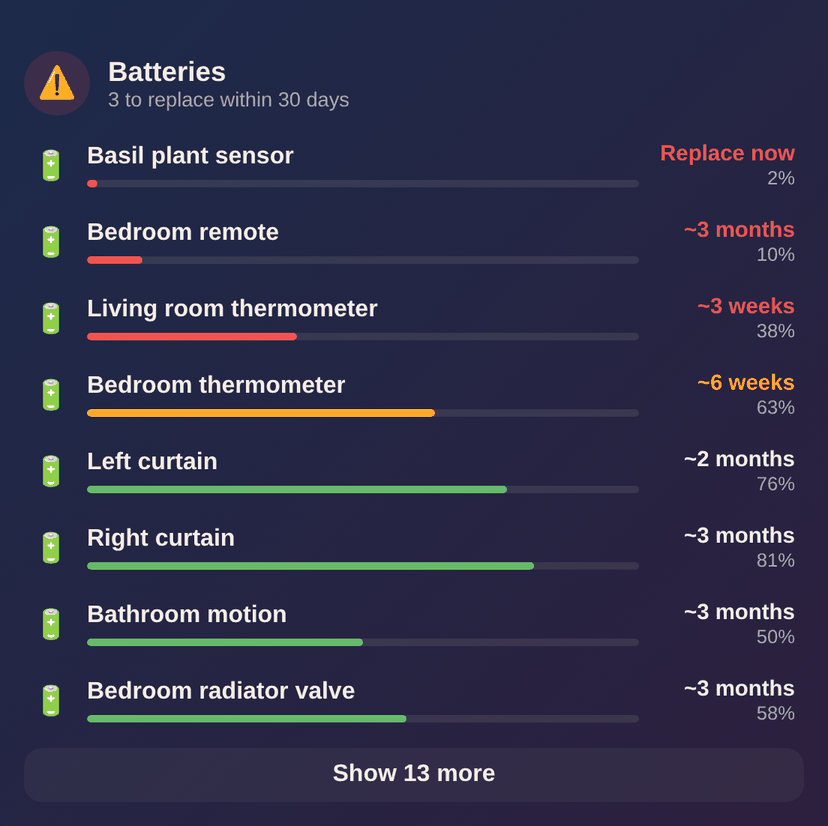

# Battery Forecast Card

A Home Assistant dashboard card that answers one question: **which battery do I need to replace next, and when?**



- **Finds your battery sensors by itself.** You don't have to list them. Phones and tablets from the Companion app are left out automatically.
- **Estimates the days left** from Home Assistant's own long-term statistics (the last 60 days, nothing to set up), and sorts the list by urgency.
- **Notices when you replace a battery** and starts the estimate again from the new one.
- Uses only the **most recent 30 days** for the estimate, because batteries drain faster near the end.
- Shows the **battery type** (AAA, CR2032…) when Home Assistant knows it, for example from [Battery Notes](https://github.com/andrew-codechimp/HA-Battery-Notes) or from Matter devices.
- Colours: **red** = replace within 30 days (or below 20%), **orange** = within 60 days, **green** = fine.
- Tap a row to open the sensor's details.
- No dependencies, no helpers or template sensors to create.

## Installation

### HACS (custom repository)
1. Open HACS → ⋮ → **Custom repositories**.
2. Add `https://github.com/Diess-tech/battery-forecast-card` with category **Dashboard**.
3. Install **Battery Forecast Card**, then reload the browser.

### Manual
1. Copy `battery-forecast-card.js` to `/config/www/`.
2. Go to Settings → Dashboards → ⋮ → **Resources** → add `/local/battery-forecast-card.js` as a *JavaScript module*.

## Usage

The simplest version is one line:

```yaml
type: custom:battery-forecast-card
```

Most homes will want to leave out a few rechargeable devices, like a robot vacuum or an electric car:

```yaml
type: custom:battery-forecast-card
exclude:
  - sensor.robot_vacuum_*
  - sensor.my_car_battery
```

Or choose the sensors yourself, with optional custom names and battery types:

```yaml
type: custom:battery-forecast-card
entities:
  - sensor.front_door_battery
  - entity: sensor.0x08ddebfffee2c972_battery
    name: Bedroom remote
    type: CR2032
```

## Options

| Option | Default | Description |
|---|---|---|
| `entities` | auto | Your own list of sensors: strings or objects with `entity`, `name`, `type`. Without it, every `sensor` with `device_class: battery` and unit `%` is used. |
| `exclude` | `[]` | Entity IDs to leave out. `*` works as a wildcard. |
| `include` | `[]` | Extra entities to add to the automatic list. |
| `exclude_platforms` | `[mobile_app, browser_mod]` | Integrations whose battery sensors are skipped. These are usually phones and tablets you recharge. |
| `title` | "Batteries" | Card title. Set it to `""` to hide the header. |
| `limit` | `10` | Rows shown before **Show more**. Set it to `0` to show all. |
| `threshold` | `5` | The level, in %, at which a battery counts as empty. |
| `warning_days` | `30` | Red when the battery will be empty within this many days. |
| `caution_days` | `60` | Orange when the battery will be empty within this many days. |
| `low_level` | `20` | Red anyway below this level. |
| `days_history` | `60` | How many days of statistics to read. |
| `days_window` | `30` | How many of the most recent days are used for the estimate. |
| `show_unavailable` | `true` | Also list sensors with no value, at the bottom. A silent sensor often means a dead battery. |
| `show_type` | `true` | Show the battery type badge. |
| `language` | from HA | `en` or `it`. |

## How the estimate works

1. The card reads the **daily average** of each battery sensor from Home Assistant's long-term statistics. The recorder keeps these averages forever for any sensor with a `state_class`, which battery sensors normally have.
2. If the level **jumps up by at least 10 points, above anything seen in the previous week**, the battery was replaced. Only the data after that point counts. Jumps from batteries whose reading simply bounces up and down are ignored.
3. On the last 30 days it fits a straight line and works out the **% lost per day**.
4. Days left = (current level − 5%) ÷ % lost per day.

You will see **"Estimating…"** until there are at least 7 days of data after the last replacement, and **"Stable"** when the level isn't going down.

Statistics are reloaded every 6 hours. The current level updates live.

---

## 🇮🇹 In breve

Card per Home Assistant che mostra **quale batteria cambiare per prima e fra quanto**. Trova da sola i sensori batteria (esclusi telefoni e tablet) e stima i giorni rimasti dalle statistiche degli ultimi 60 giorni. Si accorge quando cambi la pila e, se lo conosce, mostra il tipo (AAA, CR2032…). Non serve creare helper o sensori. Con `exclude` togli i dispositivi ricaricabili, come aspirapolvere o auto. La lingua italiana si attiva da sola se Home Assistant è in italiano.

## License
MIT © 2026 Davide Sanna
